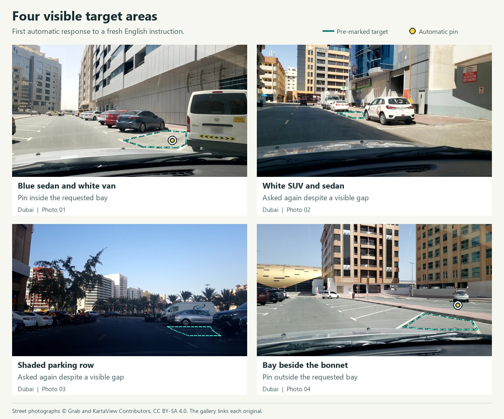
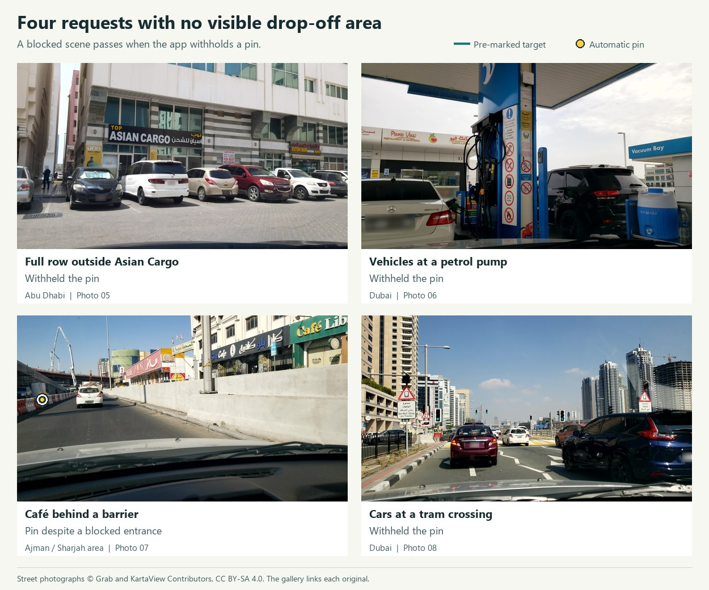

# Passenger drop-off on eight new UAE photos

The released passenger app answered **4 of 8 first requests correctly**. Its pin landed in 1 of 4 visible target areas. It withheld a pin in 3 of 4 blocked scenes. In the remaining blocked scene, the passenger asked for a café entrance on the right behind a solid construction wall and the app put its pin on the left. [Frozen requests and scoring regions](../experiments/dropoff/passenger-uae-parking-fresh-protocol-20261123.json) · [Measured results](../experiments/dropoff/passenger-uae-parking-fresh-results-20261123.json)

Eight KartaView photographs came from eight UAE drives outside the project’s previous evaluations. An AI reviewer chose driver-view scenes with visible parking bays, adjacent vehicles and physical obstructions. Before running the detector or passenger models, the reviewer wrote the instructions and marked the acceptable areas. The same app used in the demo received each original image and its actual Task 1 predictions. A first-turn test counted as correct only when the proposed point fell within the premarked area or the app withheld a point on a blocked scene. This small, deliberately selected study measures visible passenger intent. A field accuracy estimate would require independent passenger labels and a representative sample. [Inputs supplied to the app](../experiments/dropoff/passenger-uae-parking-fresh-requests-20261123.jsonl)

## Where the app pointed

The turquoise outlines show the target marked before inference. Yellow circles show the model’s first suggested point. The four blocked photographs have no reference target.

Photography © Grab and KartaView Contributors. The figures add test overlays and are shared under CC BY-SA 4.0. [Dubai parking aisle](https://kartaview.org/details/7168777/1211/) · [Hotel parking strip](https://kartaview.org/details/7173145/1173/) · [Shaded parking row](https://kartaview.org/details/3333849/525/) · [Empty bays beside the pink curb](https://kartaview.org/details/7168793/16/) · [License](https://creativecommons.org/licenses/by-sa/4.0/)

Photography © Grab and KartaView Contributors. Figures are shared under CC BY-SA 4.0. [Asian Cargo in Abu Dhabi](https://kartaview.org/details/5105913/1982/) · [Dubai petrol pump](https://kartaview.org/details/5662233/314/) · [Café and construction barrier](https://kartaview.org/details/7199273/176/) · [Dubai tram crossing](https://kartaview.org/details/6693449/1144/) · [License](https://creativecommons.org/licenses/by-sa/4.0/)

| Passenger request | First reply | What the test showed |
|---|---|---|
| Between the blue sedan and white van | Correct pin | Inside the marked bay. A synthesized English recording of the same words was transcribed verbatim and produced the same point. |
| Between the white SUV and the white sedan farther ahead | Asked again | The cloud model declined the available regions. A scripted passenger tap in the visible gap was accepted. |
| In an empty bay between the silver sedan and dark SUV | Asked again | The system rejected its selected region as occupied. A scripted tap on the open parking surface was accepted. |
| In the closest empty bay beside the bonnet and pink curb | Wrong pin | The local model selected a vehicle on the far side of the divider. A scripted tap in the nearest bay was accepted. |
| Between two cars in front of Asian Cargo | Withheld | The cars occupy adjacent bays. |
| Between the white Mercedes and black Jeep | Withheld | The petrol pump occupies the requested gap. |
| Right by the café entrance | Wrong pin | The entrance is behind a continuous barrier on the right. The pin landed by the work barriers on the left. |
| Between the burgundy sedan and dark SUV ahead | Withheld | Both cars are in traffic lanes at a tram crossing. |

All three scripted corrections used a single point fixed before inference. Each passed the app’s road check and a separate confirmation step. Those three corrections are excluded from the automatic score. The voice test used a 5.33-second synthesized recording through the real speech-input and transcript-review routes. Whisper took 3.32 seconds. The parking service then returned the same coordinates as the typed request. Real passenger speech and cabin noise were outside this trial.

## Why the furniture-store request took about 40 seconds

The released app sent “could you drop me near the furniture store on the right” to its fine-tuned Qwen3-VL-8B on the laptop’s **4 GB RTX 3050**. It read 75 detector candidates, selected the parked car labeled L73 and proposed a point beside it. A rider confirmed the pin. The interaction establishes the chosen location, while the model’s recorded reference was the car. [Photo used in this timing test](https://kartaview.org/details/1129101/0/)

| Measurement on the same photo and wording | First call | Immediate repeat |
|---|---:|---:|
| Released laptop app, submit to proposed point | 46.40 s | 44.17 s |
| Laptop 8B landmark generation inside those calls | 20.28 s | 18.73 s |
| Temporary A100-40GB benchmark, request to returned landmark | 30.07 s | 1.30 s |
| A100 landmark generation inside those calls | 2.35 s | 0.76 s |

The A100 benchmark used the same image, current detections, fine-tuned adapter, processor and 2,163 input tokens. The first call included starting the cloud worker and verifying and loading the weights. Both calls chose the same parked car. The benchmark also repeated the two failed single-landmark requests from this study on the A100. Both returned exactly the same landmark as the laptop. These cloud timings end at landmark selection. The user-facing app still computes the region, checks the road and returns the pin. A separate attempt to keep the laptop model loaded ran out of available GPU memory with other local app instances open. [Timing records and verified model identities](../experiments/dropoff/passenger-uae-parking-fresh-results-20261123.json) · [How Modal starts workers](https://modal.com/docs/guide/cold-start)

The production app already uses a different cloud model for requests about a gap between two vehicles. The first such request in this study took 45.69 seconds. The five immediately following requests took 8.39–9.12 seconds each, including the study client’s image verification. On this cohort the two-vehicle route found 1 of 3 visible gaps and withheld all 3 blocked requests. The two single-landmark requests both produced wrong pins. The separate shop request and the voice follow-up are outside these eight first-turn scores.

Passing the actual cloud landmark replies through the released region and road checks in a separate replay reproduced the exact original pins on the furniture store, near-bay and blocked-café photos. The A100 timing establishes that this stage can run faster. The two incorrect locations still need a change to how the app interprets the passenger’s landmark and the visible access route.

For a demonstration, show the first suggestion and let the passenger inspect or correct it. For storefront requests, two changes merit testing. Require visual evidence of the named entrance before offering a point, and check whether a barrier or divider separates the target from the vehicle.
