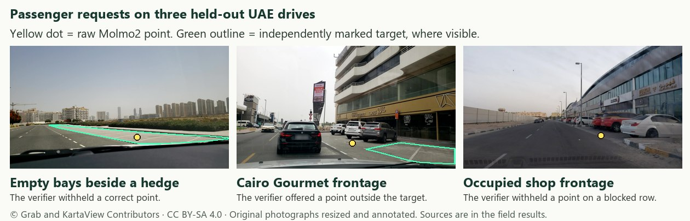

# Passenger drop-off at UAE storefronts and driveways

## Can a dedicated pointing model find the ground?

On a subsequent ten-photo test, Molmo2-8B pointed inside four of five independently marked visible targets. It also produced a point on all five blocked frontages. Its own image check rejected all four accurate suggestions. Giving the trained Qwen3-VL-8B a full scene and an enlarged crop, then checking the exact pixel against Mapillary parking and road classes, still yielded zero accurate first pins. It added a wrong pin at Cairo Gourmet. This experiment therefore stayed outside the automatic release. [Per-photo outputs, polygons, original sources and frozen scoring rule](../experiments/dropoff/passenger-frontage-pointing-20261123.json)

The reference polygons represent independent visual review. A real passenger's intention requires their own words and confirmation. Photos by © Grab and KartaView Contributors, resized and annotated under [CC BY-SA 4.0](https://creativecommons.org/licenses/by-sa/4.0/).

A later test froze a confidence model fitted on 26 other drives before scoring eight unseen UAE scenes. The previous system located zero of four visible targets. Combining the specialist's point, language-conditioned surface maps and the trained Qwen scene and crop checks located one of four, a recessed garage entrance. Both systems withheld pins on all four blocked scenes and each misplaced one pin on a visible scene. These counts describe an independent AI review of original images. [All eight results and source locations](../experiments/dropoff/passenger-frontage-confidence-test-20261123.json)

The passenger can select **Mark my spot on the photo** as soon as the original opens. Marking skips automatic guessing. The app checks the chosen surface, shows a proposed pin and asks for confirmation. On an eligible public place request, the extra automatic check can reuse a verified result for the same photo, instruction and current vehicle boxes. If its cloud models are still warming after five seconds, the primary response remains available.

The exercise also uncovered a separate routing bug. “At Cairo Gourmet”, “outside the blue auto repair workshop” and “to the left of the Dog Spot sign” sent three place requests to the laptop fallback. Two exhausted its memory and one produced a wrong pin. After correcting how the app recognises business names and spatial phrases, all three returned a clarification through the regular public-photo model. These three replays use already-opened test cases.

The field trials used publicly attributed originals and model calls on Modal. `tools.passenger_frontage_weights` downloads the pinned research weights to the workspace volume. `tools.passenger_frontage_pointing` reproduces the pointing trial and `tools.passenger_frontage_surfaces` generates the separate CLIPSeg maps. Each tool checks the public source manifest and original SHA-256 before uploading a photograph. The release also verifies the exact photograph and request before it accepts a manual correction after a place-service outage.

## Previous two cohorts

On 16 new UAE drives, the released app placed its first pin inside **0 of 8 visible targets** and asked for clarification on **all 8 blocked or ambiguous scenes**. After we opened the reference areas, one scripted passenger mark per visible target produced **8 of 8 confirmed pins inside those areas**. This measures two different operations. The first tests whether the app can locate the target by itself. The second tests whether it can preserve a passenger’s choice, check for road support and obtain confirmation. [Case results and first-response records](../experiments/dropoff/passenger-frontage-results-20261123.json)

## Try it in the regular app

Open the villa scene and say or type **“Could you let me out on the driveway of the first arched villa on the left?”** In our release check the app asked for clarification. Tap the entrance pavement you mean, select **Check my spot**, inspect the blue pin, then choose **Confirm this spot**. You can also answer in words. The second link opens the roundabout scene with visible parking bays. [Villa driveway](http://127.0.0.1:8775/?scene=8e586163045c8dbc54ed00c1) · [Roundabout parking](http://127.0.0.1:8775/?scene=67c8b96416f1dc9f40a21a72) · [Installation and startup](passenger-release.md)

## Automatic first responses

At launch, we also checked the existing two-vehicle specialist on five previously evaluated scenes. It placed correct first pins on three of four visible gaps and asked for clarification on the blocked case. On the fourth visible gap, an earlier shop-front example, two new attempts asked for clarification. The vehicle anchors matched the earlier successful run, but the segmenter assigned different parking pixels and the selector declined the spot. The regular demo opens the white SUV example that passed both evaluations. [Live launch checks](../experiments/dropoff/passenger-launch-check-20261123.json)

| Eight previously unseen drives per comparison | Released app | Experimental approach |
| --- | --- | --- |
| First group, four visible targets | 0 correct, 1 wrong pin, 3 clarifications | 0 correct, 1 wrong pin, 3 clarifications |
| First group, four blocked or ambiguous scenes | 4 clarifications | 3 clarifications, 1 wrong pin at a hospital junction |
| Second group, four visible targets | 0 correct, 3 clarifications, 1 local inference error | 0 correct, 3 clarifications, 1 local inference error |
| Second group, four blocked or ambiguous scenes | 4 clarifications | 4 clarifications |

The first experimental approach added ordinary curbside asphalt to the places Qwen could consider. It recovered two previously missed development examples, then placed a pin in the junction outside Burjeel hospital on the first independent group. The second approach localized the named landmark separately and inspected an enlarged view of the nearest marked bay. On the second group, the seven requests that reached the parking route had no eligible bay, so Qwen never received a candidate. The villa wording went to the laptop grounder and both runs failed. Neither experiment qualified for release. Their source remains available for reproduction. [Experimental code](https://github.com/A1Prep/TrackRAG-Gulf/tree/eec1f50) · [Scoring record](../experiments/dropoff/passenger-frontage-results-20261123.json)

Three different failures appear in the original images. At the roundabout, five of six candidate points were inside the marked parking area. Qwen selected one and later rejected it. At the Mercure hotel, most of the arrival area was classified as ordinary road. At the white building in the second set, the segmenter recognized the parking strip, but the vehicle exclusion and clearance checks removed every candidate. These errors occurred at different stages. [Per-photo model decisions and road-mask diagnosis](../experiments/dropoff/passenger-frontage-results-20261123.json)

## Passenger-marked recovery

The published records contain the complete signed segmentation maps and language replies for 30 of the 32 first turns. We reproduced all 30 decisions from the installed public photos and their detector inputs. The other two records preserve the local villa inference errors. [Portable inference receipts](../experiments/dropoff/passenger-frontage-receipts-20261123.jsonl) · [Detector inputs and original requests](../experiments/dropoff/passenger-frontage-requests-20261123.jsonl)

After both comparisons, we repeated the eight visible requests through the regular app. We used one small mark at the most interior point of each frozen reference area, with the same rule on every photo. Seven first responses asked for clarification. The eighth offered the wrong St Regis pin, which the scripted passenger replaced. In all eight cases the checked pin stayed inside the reference area, a confirmation with an invalid identifier was rejected, and a separate confirmation recorded the passenger’s choice. These marks came from the opened references. A human passenger study would measure how readily real riders can identify and mark the intended spot.

The updated app recognizes driveway, forecourt and villa requests. The same villa wording that had exhausted laptop memory reached the approved public-photo grounder in 5.26 seconds, asked for clarification, and accepted a passenger-marked point. On the furniture-store photo, the app rejected a mark on an occupied area and left the request open for another choice. In Edge, a typed desktop request completed through to confirmation, and a synthetic speech WAV transcribed by Whisper on an emulated phone completed through transcript review, clarification, the rejected mark and cancellation. [Recorded outcomes](../experiments/dropoff/passenger-frontage-results-20261123.json)

## Photos and source credits

Green outlines show independently marked areas. Red crosses show wrong automatic pins. Blue dots show the later checked passenger marks. An independent AI reviewer froze all expected responses and visible polygons before seeing the two sets of model outputs. The 16 photographs were deliberately selected to include clear and difficult cases. The figures describe visual placement on these drives. The driver decides where a stop is permitted.

© Grab and KartaView Contributors. The gallery resizes the source photos and adds outlines, pins and captions. Gallery derivatives use the same licence. The installer verifies each original against its recorded SHA-256. [CC BY-SA 4.0](https://creativecommons.org/licenses/by-sa/4.0/) · [Original photographs and download records](../experiments/dropoff/passenger-frontage-photos-20261123.json)

| First group | Second group |
| --- | --- |
| [Red and glass building](https://kartaview.org/details/1119285/104/) | [Lulu Exchange](https://kartaview.org/details/1257895/48/) |
| [Burjeel hospital](https://kartaview.org/details/5299897/55/) | [Orange parking sign](https://kartaview.org/details/66346/113/) |
| [Starbucks entrance](https://kartaview.org/details/3075690/358/) | [Green bins](https://kartaview.org/details/166806/131/) |
| [Roundabout parking](https://kartaview.org/details/5200729/338/) | [White canopy](https://kartaview.org/details/5053449/2/) |
| [Yellow skip](https://kartaview.org/details/976103/139/) | [Yellow forklift](https://kartaview.org/details/54900/393/) |
| [Mercure hotel](https://kartaview.org/details/6581529/932/) | [Villa driveway](https://kartaview.org/details/986841/26/) |
| [St Regis](https://kartaview.org/details/5204473/819/) | [Brixton shop](https://kartaview.org/details/6315033/178/) |
| [Just Play](https://kartaview.org/details/1269447/242/) | [White building parking strip](https://kartaview.org/details/4572137/14/) |
