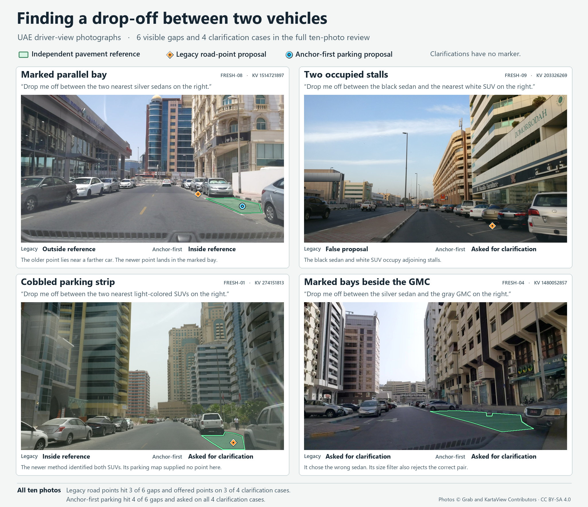

# Finding a passenger's requested gap between parked vehicles

The strongest first response in our new UAE photo trial came from identifying the two named vehicles, then looking for parking surface between them. It found four of six visible gaps and issued no points on the four blocked or ambiguous scenes. The ordinary road-point selector found three gaps and issued three false points on those same four scenes. On the earlier development photos, the new method found three of eight gaps. It needs a way for the passenger to correct it. [Case-level decisions, original frame dimensions, reference polygons, source links and model revisions](../experiments/dropoff/passenger-uae-gap-diagnosis-20261123.json)

The outlined areas come from an independent visual reviewer. A point marks the actual first response on the original photo. The gallery overlays, labels and resizing are adaptations. Photos © Grab and KartaView Contributors, licensed under CC BY-SA 4.0. The figure is shared under the same license. [Parallel bay](https://kartaview.org/details/5331945/29/) · [Occupied or ambiguous scene](https://kartaview.org/details/1129101/0/) · [Light-coloured SUVs](https://kartaview.org/details/1258531/39/) · [Silver sedan and GMC](https://kartaview.org/details/5124937/12/) · [CC BY-SA 4.0](https://creativecommons.org/licenses/by-sa/4.0/)

## What failed in the original application

Nine of the original 15 two-vehicle requests stopped before the 8B model ran. Eight descriptions matched too many plausible vehicles under the visual-colour rule, and one lacked a confident colour match. Six requests reached the model, but the app could not establish the intended pair. Even supplying the independently marked vehicles for all eight positive cases yielded zero proposed points. Seven lacked the road-edge evidence required by the app and one lacked an adequate neighbourhood of road pixels. Its Cityscapes road model distinguishes roads and sidewalks. The Mapillary Vistas model used in the new trial has separate labels for **Parking** and **Road**. [Previous UAE test](passenger-uae-road-check.md) · [Parking model label definitions](https://huggingface.co/facebook/mask2former-swin-large-mapillary-vistas-semantic/blob/4772b6bf101d91f2534c106dc524d906aeb3c68a/config.json)

## How the new method works

1. Qwen3.5-9B reads the passenger's words and the original frame and draws a box around each referenced vehicle. Each box must match a different current RF-DETR/BoT-SORT observation. An uncertain match yields a clarification.
2. Mask2Former predicts the surface classes. The program examines patches labelled **Parking** between those two observations and checks for an intervening vehicle. For each qualifying patch, it places a point in the interior. Static geometry in one image estimates visible space only.
3. Qwen sees lettered points on the frame and chooses one or asks again. An invalid model reply is recorded as an error. A valid chosen point is expressed in pixels of the original photo. The regular passenger UI supports a person marking their own intended road area and confirming it after reviewing the proposed point.

## How well it worked

The ten new photographs came from ten different UAE camera sequences, excluding 123 previously surveyed sequences and the airport image. An independent AI reviewer froze the natural requests and the acceptable destination polygons before the model outputs were scored. All conditions used the same original photographs, current predicted observations and wording. The six positives had an identifiable visible patch. The four negatives required a clarification. The first-response score uses the full-resolution point in the frozen polygon, including its boundary. These were typed English instructions and there were no human study participants.

| First response on ten new photographs | Correct point / 6 visible | Wrong point on a positive | False point / 4 negative |
|---|---:|---:|---:|
| Original passenger app with the 8B model | 0 | 0 | 0 |
| Qwen3.5-9B points directly | 1 | 5 | 3 |
| Same 9B chooses among original road points | 3 | 1 | 3 |
| Same 9B chooses among parking points for all possible pairs | 3 | 2 | 1 |
| Same 9B identifies the pair first and chooses from its parking points | **4** | **0** | **0** |

The original app had four technical errors, two on positives and two on negatives. Its six other responses asked for clarification. The new pair-first method asked on the two visible gaps it missed and on all four negatives. On the earlier 15 development cases it found three of eight gaps, pointed at the wrong place once on a positive and asked on the other four positives. On the seven development negatives it asked six times and returned one technical error. Showing a passenger a proposed point and asking them to confirm remains important. A marked reference area establishes visible pavement only. It supplies no measurement of vehicle clearance, permission to stop or current moving traffic.

## The two new misses

- **Two light-coloured SUVs.** Qwen matched the two correct current vehicles. The segmenter labelled 0% of the independently outlined gap as parking surface. No point reached the selector. Increasing the language model's reasoning budget cannot select an option absent from its input.
- **Silver sedan and gray GMC.** The model chose a different silver sedan and identified the correct GMC. About 86% of the actual gap was labelled parking. After an operator supplied the two correct vehicles, the near vehicle appeared 3.95 times taller than the far one. A 3.5 limit in the pair geometry rejected it. Removing that limit with the two correct boxes produced two options inside the pre-existing reference. Qwen chose the first at pixel (2087.15, 1416.91). Of the 20 available operator-identified pairs across both sets, only this case changed. This was a follow-up after scoring. The original automatic score is still a miss.

Supplying independently selected vehicle boxes alone reproduced the same four correct points on the six new positives. In the ordinary browser an explicit road-area tap or drag is checked against the original predicted road mask and current detected objects. The UI displays a supported point, records who selected it and requests separate confirmation. On each of the two newly missed images, a test operator picked pavement without seeing the scoring outlines. The app accepted one tap on the SUVs image and one on the GMC image. Both points were individually confirmed and independently verified inside the original reference areas. No new automatic destination or passenger participant was involved in those two tests. On the earlier development scenes the app also declined a tap on a car and a tap on an unsupported corner. The interface preserves model errors and offers correction when identifying the landmarks fails. [Passenger application](passenger-release.md)

## Related work and the next experiment

Talk2Car-Destination separates the object in a passenger's command from the destination in the physical scene. It represents plausible destinations in bird's-eye coordinates and collects three human endpoint annotations per command. A published indoor parking system combines four calibrated surround cameras, detects the corners of slot entrances and associates those slots in a map. Waymo's rider interface offers eligible locations along blue lines on the map and lets the passenger adjust the destination. Together these examples motivate vehicle identification, independent ground evidence and a passenger correction step. Their sensors and metrics differ from this forward-camera photo trial. [Talk2Car-Destination](https://cdn.aaai.org/ojs/19952/19952-13-23965-1-2-20220628.pdf) · [Parking-slot mapping study](https://www.mdpi.com/1424-8220/19/1/161) · [Waymo rider instructions](https://support.google.com/waymo/answer/9696059?hl=en)

For the next automatic improvement, evaluate two or three nearby video frames with consistent tracked-vehicle identities and a ground-plane estimate. This directly tests whether another view can reveal an unmarked bay or explain the apparent size difference. Freeze independent human judgments of target areas and blocked cases from unseen drives before changing the geometric thresholds. Keep language identification, surface coverage, false proposals and passenger-assisted completion as separate measures.

## Run the GPU study on another request

Use an ordinary annotation-free passenger request JSONL with the original photo path, verified image SHA-256, current-frame predicted tracks and the passenger's text. The pair-first comparator currently looks for English commands containing the word “between”. Supply local model snapshots at the revisions recorded below. The default passenger app retains its existing 8B grounding system. The GPU study emits pending proposals and clarification decisions for analysis. The regular app verifies and confirms its own proposals and passenger marks.

The ten-photo trial has a ready-to-run request file with all 411 measured vehicle and road-user observations. From the repository root, each frame path is relative to the local data directory. In a fresh checkout, save the original_image_url for each fresh case under data/uae-parking-study using its SHA-256 followed by .jpg as the filename. The study verifies the original bytes on load. The prepared project machine already has these ten files. Reference polygons belong only to the separate scoring file. [Annotation-free requests](../experiments/dropoff/passenger-uae-gap-requests-20261123.jsonl) · [Per-photo source links and scoring data](../experiments/dropoff/passenger-uae-gap-diagnosis-20261123.json)

~~~sh
python -m tools.passenger_parking_study --requests requests.jsonl --out new-results --segment-checkpoint /models/mask2former-mapillary --qwen-checkpoint /models/qwen35-9b --anchor-first
~~~

The complete run creates class maps, raw two-vehicle replies, lettered photos, selection replies, original-pixel decisions and provenance for each stage. A real A100-40GB run from the released entry point processed the ten new photos in about 60 seconds with both checkpoints already cached. All ten decisions and all four point coordinates reproduced. This includes model initialization and processing the batch and excludes container provisioning or model downloads. The sealed board used Arial Bold. The portable run used its default font. For exact board reproduction, supply the original local font with the font-file option. The model ran with thinking switched off. The tested environment used Python 3.11, PyTorch 2.6.0, Transformers 5.6.2, Pillow 11.1.0, NumPy 1.26.4, SciPy 1.15.2, Accelerate 1.12.0 and OpenCV 4.10.0.

| Local checkpoint | Verified revision |
|---|---|
| facebook/mask2former-swin-large-mapillary-vistas-semantic | 4772b6bf101d91f2534c106dc524d906aeb3c68a |
| Qwen/Qwen3.5-9B | c202236235762e1c871ad0ccb60c8ee5ba337b9a |
