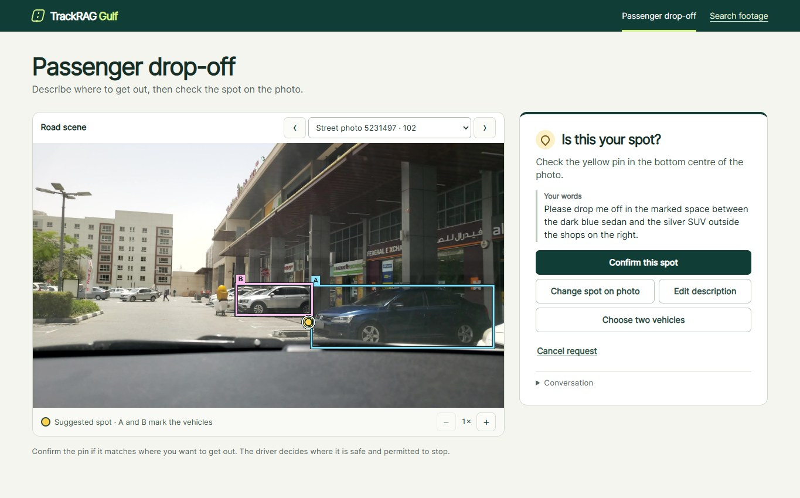
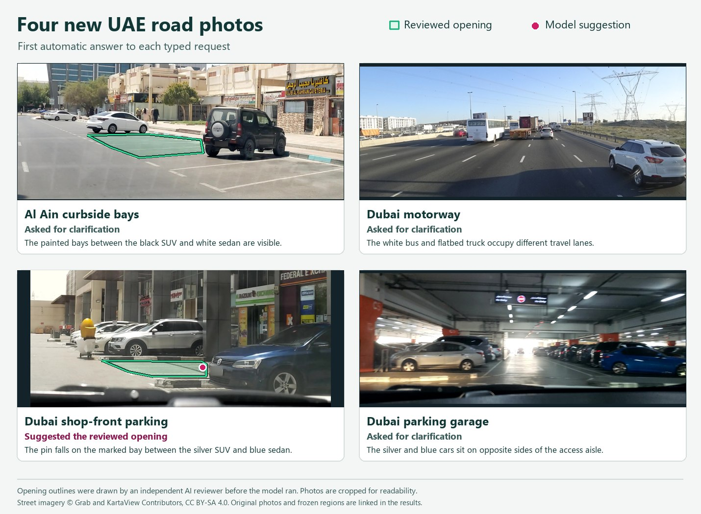
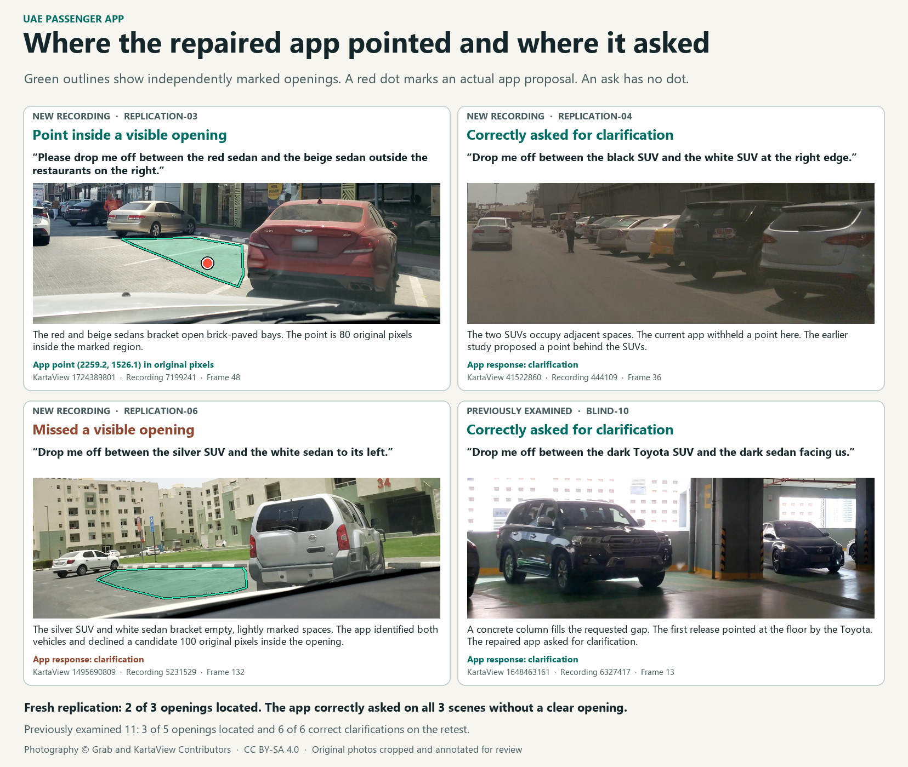

# Calling out a drop-off between two vehicles

The passenger can describe two vehicles in English, by voice or text. The app uses the current driver-view photo to identify them, outline a proposed patch and ask the passenger to confirm it. If the view is inconclusive, the passenger can clarify, select the vehicles or mark the intended area. Confirming records the passenger’s intent. The feature makes no determination about stopping permission, physical clearance or moving traffic.

## Open the prepared app

From the project root on the prepared Windows laptop, use the local grounding environment. The first command downloads and verifies the original UAE photos and writes an app-ready set of 31 scenes. It resumes from verified files. The second command opens the regular passenger and footage app with the cloud parking model enabled. Open the local page once the server prints its address.

~~~powershell
.\.venv-grounding-local\Scripts\python.exe -m tools.passenger_parking_photos
.\.venv-grounding-local\Scripts\python.exe -m tools.passenger_release start --parking-backend modal --require-footage 2 --low-memory --port 8775 --vision-cache runs/model-cache/airport-segformer-b0
~~~

The launcher includes the installed UAE photo bank and the optional two-vehicle bank. Explicit `--requests` options select exactly the listed banks. On a new machine, install the local passenger bundle, speech model and road model first. The standard support location works without the machine-specific `--vision-cache` option. [Passenger setup](passenger-release.md)

- Open the Dubai shop-front photo and type **“Please drop me off in the marked space between the dark blue sedan and the silver SUV outside the shops on the right.”** Choose **Find my spot**. On the measured run the yellow pin landed in the requested bay. Choose **Confirm this spot** if it matches your intent. [Open the shop-front photo](http://127.0.0.1:8775/?scene=f4d997a6f22c942559a798dd)
- To try voice, open the truck-and-van photo, press **Record voice** and say **“Drop me off between the white box truck and the white van, please.”** Stop, edit any incorrectly recognized words and press **Send reviewed transcript**. [Open the truck and van](http://127.0.0.1:8775/?scene=0c150fa36349744dbd66653b)
- Any catalogued recording and frame can be selected in the normal app. The case descriptions in the downloaded request bank prepare the photo and its predictions. They never supply an answer or override what the passenger enters.

The screenshot shows the first automatic proposal awaiting confirmation. The road photograph is © Grab and KartaView Contributors. This screenshot adds the interface and overlays and is shared under CC BY-SA 4.0. [Original photograph](https://kartaview.org/details/5231497/102/) · [License](https://creativecommons.org/licenses/by-sa/4.0/)

## When the app asks again

Choose **Mark my spot on the photo** to tap the intended location or drag around an area. Zoom up to 3× to see a small gap. A keyboard user can move the crosshair with the arrow keys, use Shift for larger steps and press Enter to place a mark. Choose **Check my spot** to check visible road support, then inspect the blue pin and confirm it separately. A mark on an unsupported surface can lead to another clarification. [Try the missed silver-SUV gap](http://127.0.0.1:8775/?scene=e5bde860db079a167d5dba80) · [See the confirmed passenger correction on a phone](passenger-ux-mobile.jpg)

Choose **Answer in words** to add a detail to the existing conversation. **Edit original description** replaces the request and starts the language model with the revised words and this photo. An unconfirmed suggestion also has a direct **Edit description** button. In a live test, changing from the red and beige sedans to the white taxi and dark sedan produced a different pair and pin. The previous confirmation was rejected. A separate follow-up preserved the original words and the assistant’s question. [Verified turns, model inputs and proposal IDs](../experiments/dropoff/passenger-request-edit-20261123.json)

On a 390 × 844 phone viewport, the entire **Find my spot** button was visible on entry. Its upper edge moved from 840 to 654 pixels. A desktop microphone trial used synthesized English speech through the real browser recorder and local Whisper recognizer. It transcribed all 15 words, allowed a correction and submitted the reviewed wording. We also tested a refused microphone, an empty recording and a failed photo load. The mobile screenshot adds the interface and blue passenger pin to the original road photo, © Grab and KartaView Contributors, CC BY-SA 4.0. [Browser evidence](../experiments/dropoff/passenger-ux-browser-20261123.json) · [Mobile source photo](https://kartaview.org/details/5231529/132/) · [License](https://creativecommons.org/licenses/by-sa/4.0/)

## Further tests of the automatic suggestion

| Trial | Visible gaps correctly marked | Blocked requests correctly withheld | Correct first replies |
|---|---:|---:|---:|
| Four previously unscored UAE photos | 1 of 2 | 2 of 2 | 3 of 4 |
| Eight new descriptions on six previously scored photos | 2 of 5 | 3 of 3 | 5 of 8 |

The app found the Dubai shop-front bay, missed the Al Ain bays and requested clarification on the motorway and in the garage. An AI reviewer marked the scoring regions before inference. Three of the four photos came from drives outside the earlier photo bank. The Al Ain photo was a different frame from a familiar drive. All four missed positive requests across the two trials had a candidate inside the reference region. The final selector declined it. [Predeclared cases, exact coordinates and results](../experiments/dropoff/passenger-ux-road-validation-20261123.json)

Those four misses occurred on three distinct photos. In a separate follow-up we opened each photo again, submitted the original words and got the same clarification. We then simulated one passenger tap at the predeclared centre of each reference region. On **all three** photos the road check returned a point inside the region, which was confirmed in a separate action. This included the missed Al Ain bays. The first-turn scores above count only automatic proposals. [Try the Al Ain photo](http://127.0.0.1:8775/?scene=d76c4ca006dc9332d37ec750) · [First replies and assisted follow-up evidence](../experiments/dropoff/passenger-ux-road-validation-20261123.json)

The comparison crops and annotates road photographs by Grab and KartaView Contributors under CC BY-SA 4.0. [Al Ain bays](https://kartaview.org/details/7130313/1395/) · [Motorway](https://kartaview.org/details/3849837/74/) · [Dubai shopfront](https://kartaview.org/details/5231497/102/) · [Garage](https://kartaview.org/details/5204489/936/) · [License](https://creativecommons.org/licenses/by-sa/4.0/)

We also replayed 42 scripted taps on 17 previously scored photos. The old phone-sized tap could snap from a small motorway car to road below it. The revised tap covers the same original-image area at every display size and zoom. It rejected all 34 vehicle-body taps and placed 7 of 8 gap-centre taps inside their reference regions. The remaining gap was on gravel that the road model failed to recognize. These assisted scores measure how the app handles a supplied point. [Tap coordinates, results and live confirmation checks](../experiments/dropoff/passenger-precise-tap-20261123.json)

## Earlier automatic tests on UAE driver-view photographs

An earlier test used six unseen drives from Dubai, Ajman and Sharjah. The passenger app found **two of three visible openings** and asked for clarification on **all three blocked scenes**. It declined one actual opening between a silver SUV and a white sedan. Five of six first responses met the pre-defined criterion. All six used real detector outputs and model calls. A separate reviewer marked the acceptable regions before inference and saw the predictions only after they were saved. [Case-level results, exact words, reference regions and model outputs](../experiments/dropoff/passenger-uae-parking-results-20261123.json)

| Same six new drives | Correct location in 3 visible openings | Correctly withheld a point on 3 blocked scenes | Technical errors |
|---|---:|---:|---:|
| Released passenger app | 2 | 3 | 0 |
| Previous parking study | 2 | 2 | 0 |
| NVIDIA LocateAnything-3B, directly asked to point | 1 | 0 | 0 |

Green outlines are the independent reviewer's reference regions. Red dots are actual automatic proposals projected from original-image coordinates. The photos were cropped and annotated for comparison. © Grab and KartaView Contributors, CC BY-SA 4.0. [Brick-paved parking row](https://kartaview.org/details/7199241/48/) · [Adjacent SUVs](https://kartaview.org/details/444109/36/) · [Missed opening](https://kartaview.org/details/5231529/132/) · [Garage pillar](https://kartaview.org/details/6327417/13/) · [License](https://creativecommons.org/licenses/by-sa/4.0/)

The NVIDIA pointing instruction always requested a location. It found the opening the other methods missed, but also returned a point on all three blocked scenes. On ten earlier photos, a separate test using its vehicle-box prompts correctly identified both named vehicles in eight cases. This helps explain why detecting the cars alone leaves the destination unresolved. Research such as Talk2Car-Destination annotates the destination separately from the referred object and supplies top-down information. [NVIDIA model and evaluation](https://research.nvidia.com/labs/lpr/locate-anything/) · [Talk2Car-Destination annotations](https://github.com/ThierryDeruyttere/Talk2Car-Destination)

In the missed silver-SUV scene, the released system identified both vehicles and generated a candidate 100 original pixels inside the reference opening. The final selector declined it. We also tested two confirmation-style question prompts on eleven previously proposed points. Both accepted every point, including the two known false proposals. Those results informed the decision to check the geometry and the surface under each proposed footprint.

In the first round on a different set of eleven new drives, the app got **5/11** first responses right. It suggested a location behind a tightly parked coupe and another in the driving aisle in front of a garage pillar. Two unfamiliar descriptions reached a failing local GPU worker. After the fixes, the same eleven yielded **9/11**. Three of five visible gaps were correctly marked and all six blocked scenes drew a clarification. These eleven informed the repair. The six-drive results above measure it on different recordings.

The earlier 25 development photos were harder. The released app found **5/14** visible openings and asked on **11/11** blocked scenes. The first integrated version found **6/14** and the standalone parking study **7/14**. The added checks can turn a real opening into a clarification. A person can still mark a missed area and review the resulting proposal. These figures describe curated still images with independent AI visual references. They do not measure driver acceptance, legal stopping or performance on a moving vehicle.

For a browser-level check, one typed instruction and one reviewed spoken correction produced displayed proposals on different recordings. Both took a separate confirmation click and passed offline verification against the same photograph and model inputs. The English audio was synthesized and transcribed locally with Vosk. No human passengers participated. [Typed example](http://127.0.0.1:8775/?scene=7520651abea7382db45fcc04) · [Voice example](http://127.0.0.1:8775/?scene=0c150fa36349744dbd66653b)

## How the app makes the decision

1. A language check routes an active request about a gap between vehicles to the parking service. It preserves the passenger’s words. If one of the two vehicle types is unclear, the app can ask the passenger to restate it or mark the area. Speech is transcribed locally. The app sends the current original road photo, reviewed words and predicted observations to the team’s private Modal service. Other passenger requests use the existing trained Qwen3-VL-8B route. Footage questions use the separate evidence-retrieval route.
2. Qwen3.5-9B identifies the named vehicles in the image. Its boxes must match distinct current RF-DETR/BoT-SORT observations. A second view with numbered vehicle crops helps when the first reading cannot locate a parking patch.
3. A Mapillary Vistas Mask2Former identifies parking surface, road, sidewalk and other scene classes. The system considers patches within the region between the vehicles and removes observed obstacles. An ordinary-road patch also needs nearby curb or sidewalk and parking evidence. Two vehicle readings must agree before the app considers that fallback.
4. Qwen sees a bounded set of lettered parking locations in their original order and can decline them all. The app checks that the selected point sits inside an unobstructed patch. It also samples the predicted surface at several heights between the vehicles. Evidence of a structure reaching the estimated ground level triggers a clarification. If the model selects an unsupported point, it may only choose another eligible location from that original display. Where no conventional parking candidate exists, the guarded roadside search can inspect a full photo and an enlarged crop. The final dot and its rectangle use original-photo coordinates.
5. The laptop verifies the model’s signed replies against the original bytes, the instruction, the predicted map and the exact candidate images. It checks again on confirmation. An unavailable service, clarification, separate passenger correction and confirmed automatic proposal have distinct audit records.

The specialized route uses released model weights. The previously fine-tuned 8B remains part of the application. The parking-label definitions and both revisions are fixed. [Parking segmentation checkpoint](https://huggingface.co/facebook/mask2former-swin-large-mapillary-vistas-semantic/blob/4772b6bf101d91f2534c106dc524d906aeb3c68a/config.json) · [Qwen3.5-9B revision](https://huggingface.co/Qwen/Qwen3.5-9B/tree/c202236235762e1c871ad0ccb60c8ee5ba337b9a)

## Connect another team machine

Sign in to the same Modal workspace from a separate Python 3.11 environment with `modal==1.6.4` installed. Set `TRACKRAG_MODAL_PYTHON` to that environment’s Python executable, or put the environment at `.venv-modal` in the repository. Start the regular app with the options above. The local release uses Pillow 11.1.0 to reproduce the GPU’s marked images. The two cloud model weights stay on Modal. The service runs on demand, with at most one A100 and a 30-second idle window, so live use consumes workspace compute.

The current deployment is private. Its two read-only model volumes and receipt-signing secret belong to the team workspace. To deploy a code change there, run `python -m modal deploy -m tools.passenger_parking_modal` in the authenticated Modal environment. The app pins the matching public verification key. An independent workspace also needs its own signing secret, matching public key and verified model snapshots. [Deployment configuration](../tools/passenger_parking_modal.py)

The photographs are © Grab and KartaView Contributors, used under CC BY-SA 4.0. The photo manifest links each original and records its SHA-256. The source files stay outside Git. [Photo credits and sources](../experiments/dropoff/passenger-uae-parking-photos-20261123.json) · [License](https://creativecommons.org/licenses/by-sa/4.0/)
