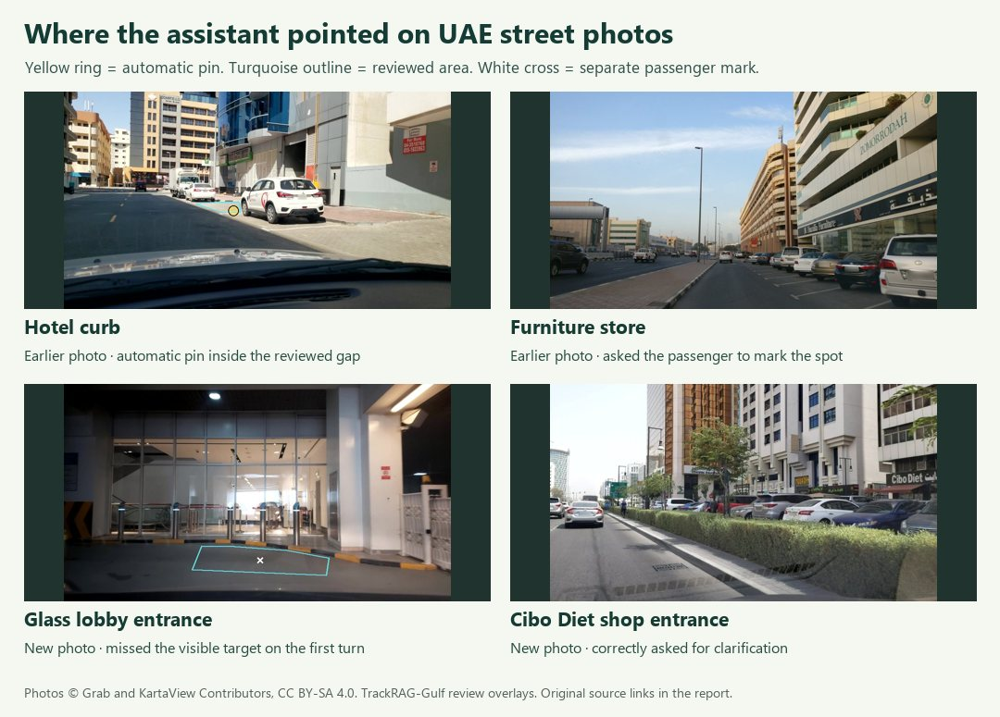

# Passenger drop-off checks on UAE street photos

The app found the requested gap on three previously reviewed photos in a live retest. On eight new photos it asked the passenger to clarify every request. Four of those scenes contained an identifiable target. Automatic placement still needs work at entrances, pull-ins and ordinary curbs. [Case-by-case results](../experiments/dropoff/passenger-places-and-gaps-results-20261123.json)



Original photographs by Grab and KartaView Contributors. [Hotel curb](https://kartaview.org/details/7173145/1173/) · [Furniture store](https://kartaview.org/details/1129101/0/) · [Glass lobby entrance](https://kartaview.org/details/4574809/203/) · [Cibo Diet shop](https://kartaview.org/details/5139769/64/)

| Evaluation | Earlier release | Updated app |
| --- | --- | --- |
| 17 visible gaps in previously reviewed two-vehicle requests | 9 pins in the marked area | 12 pins in the marked area |
| 16 blocked two-vehicle requests from that set | 16 correctly withheld | 16 correctly withheld |
| 4 visible targets on fresh UAE photos | 0 pins in the marked area | 0 pins in the marked area |
| 4 blocked requests on fresh UAE photos | 1 correct clarification | 4 correct clarifications |
| Replies on the eight fresh requests | 2 clarifications and 6 local GPU memory errors | 8 clarifications |
| Separate scripted correction on the four missed targets | — | 4 marked, explicitly confirmed and verified |

The 33 earlier requests covered 25 photographs. Their signed first-pass calls were replayed against the saved originals. Four requests triggered one extra visual check. No earlier correct result changed to an incorrect one. Separately, the hotel, medical-centre frontage and blue-and-white curb were submitted again through the ordinary app. All three live points fell inside their reviewed polygons, by 17.2, 40.6 and 57.0 original-image pixels respectively. These were selected examples. [Results and model-call records](../experiments/dropoff/passenger-places-and-gaps-results-20261123.json)

An independent AI reviewer selected eight original KartaView photographs from seven previously unused UAE drives and froze the requests, acceptable polygons and correction taps before inference. The baseline used commit c9e987b. The team inspected two request wordings while diagnosing GPU errors and fixed the routing and runtime before scoring. The acceptance regions stayed sealed until the final first-turn predictions were saved. Positive cases require a pin inside the original-image polygon. Errors receive no credit. Passenger corrections have their own score. These references measure agreement with a visual reviewer. A person who actually rode or drove the route has yet to validate the app. [Frozen reference](../experiments/dropoff/passenger-places-independent-reference-20261123.json)

## What the passenger experiences

- For a request between vehicles, the existing image model identifies both vehicles. If its first result is inconclusive, a candidate in the central third between their predicted ground contacts can receive one additional visual inspection. The model must recognize both references and classify the marked area as an opening. Adjacent and overlapping vehicles can still trigger a clarification.
- On explicitly listed public photos, the place route uses the Task 1 detections and a parking-surface segmentation model to propose regions of visible pavement. It removes current vehicle footprints and narrow strips behind them. Where candidates remain, the project's fine-tuned Qwen3-VL-8B reads numbered points and then inspects its chosen point. The signed evidence binds both model views and responses to the submitted words and photograph. For an image with no eligible region, the surface check asks for clarification immediately and skips loading the language model.
- The passenger can speak or type, edit the transcript, inspect the proposed pin, mark a different location and explicitly confirm. The interface draws a pin for a model-estimated location whose surrounding extent has not been verified. Passenger-drawn areas retain their outline. Confirmation records the passenger's preference. The driver makes the stopping decision.

The furniture-store photo previously produced a pin using a parked vehicle as the storefront reference. In the updated app, the remaining pavement consisted of narrow strips by the parked row, so the app asked for a mark. The blocked café entrance also produced a clarification. On the eight fresh photos, the parking-surface rule excluded visible entrance and roadside areas along with genuine obstructions. In two further single-landmark rephrasings of known parking scenes, the app also asked again. The principal open problem is recognizing an accessible roadside stopping area when the street surface is classified as ordinary road. [Measured results](../experiments/dropoff/passenger-places-and-gaps-results-20261123.json)

Inspection of the saved predictions localized the four misses. The surface model classified every reviewed lobby pixel as ordinary road. The bay beside the construction fence also had zero parking-class pixels. Those two targets never reached Qwen as candidates. On the pull-in behind the dark car, the only candidate was inside the reviewed area. Qwen selected it, then rejected it as blocked during its second inspection. For the two white sedans, the vehicle-pair route found no supported roadside patch. These observations identify distinct failure points for the next evaluation. [Per-scene map and candidate counts](../experiments/dropoff/passenger-places-and-gaps-results-20261123.json)

Three further requests used previously seen photographs and new wording. The app asked for clarification on the visible Prolab bay and the brick bay by a blue pickup. The local model ran out of memory on a request near delivery motorcycles. In a separate live recovery test, the app retained the resource error and offered manual marking after checking the original photograph. A scripted mark on a different road patch produced a passenger-selected proposal, required confirmation and passed the journal check. This interaction is counted only as software recovery. [Additional cases and recovery evidence](../experiments/dropoff/passenger-places-and-gaps-results-20261123.json)

In a local HTTP test on the same furniture photo, the first request after Modal reported zero running place containers took **18.52 seconds**. Two immediate repeats took **4.96 and 4.80 seconds**. Each used segmentation and returned the same clarification. This timing excludes language generation because that particular photo had no eligible candidate; requests with candidate regions also run the trained 8B. Older versions often loaded the language model at startup regardless of the scene. [Timing and conditions](../experiments/dropoff/passenger-places-and-gaps-results-20261123.json)

## Running the public-photo route

In the existing passenger environment, use the release command with the public source list for the photos being served. A source list authorizes matching original bytes, recording and frame. Scene banks still supply the photographs and Task 1 predictions. For the eight-photo check we also supplied its prepared bank through a further `--requests` argument. [Passenger installation and model bundle](passenger-release.md)

```text
python -m tools.passenger_release start --parking-backend modal --place-public-sources experiments/dropoff/passenger-uae-parking-photos-20261123.json --place-public-sources experiments/dropoff/passenger-place-public-photos-20261123.json --require-footage 2 --low-memory
```

The two private Modal classes scale to zero. The place service receives the listed public photograph, dimensions, current detection boxes, the necessary passenger words and an opaque request digest. Audio and local paths stay on the passenger machine. Unlisted images keep the existing local place route. Original photographs, personal sessions, signing keys and trained checkpoints stay outside Git. The held-out images and gallery overlays are credited to Grab and KartaView Contributors under CC BY-SA 4.0. [KartaView licensing](https://kartaview.org/terms)
