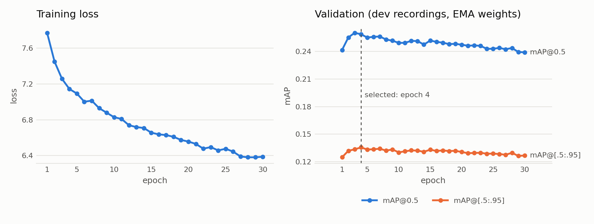
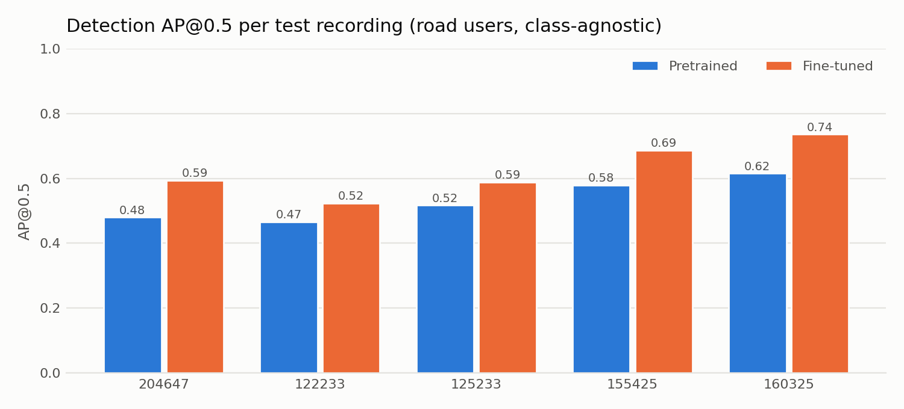
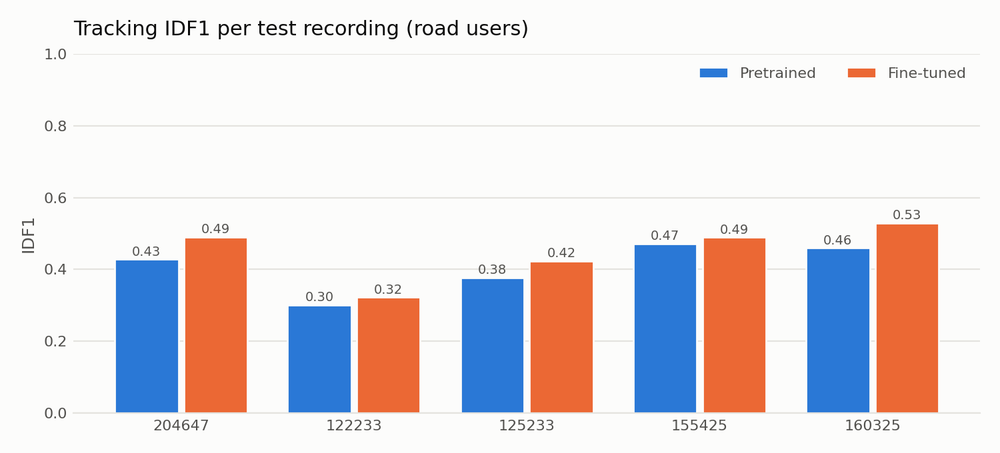
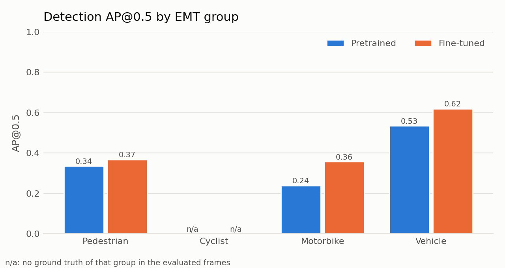
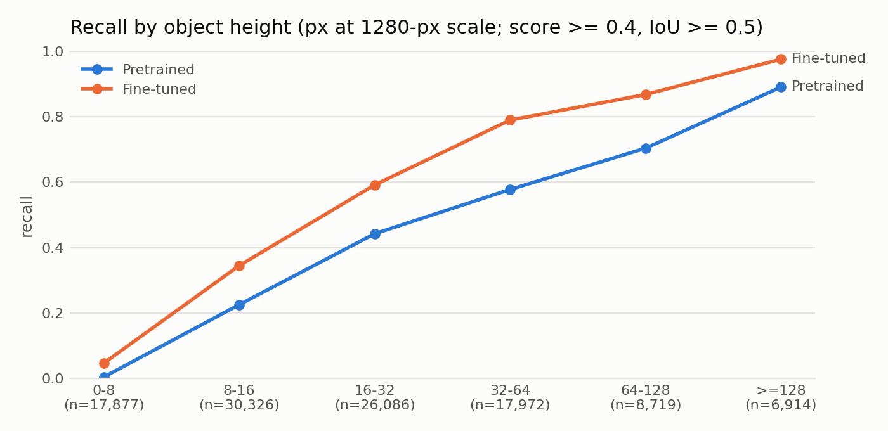

# Task 1: detecting and tracking road users

Task 1 provides `trackrag.vision.predict_tracks(recording)`. In each frame of a recording, RF-DETR Large detects the road users, and BoT-SORT links those detections over time. The function returns one `TrackObservation` per road user per frame, with `source: "predicted"`. Boxes are the detector's own boxes in original-image pixels, class names are EMT names, and track IDs restart at 1 for every recording.

The output is online: the rows for frame *t* depend only on frames up to *t*. Retrieval that stops at a question's query frame therefore cannot see later frames through Task 1. Predictions never use ground-truth labels as input; labels are read only for training and by the evaluation tool.

Two models are compared: the COCO-pretrained RF-DETR Large checkpoint, and the same model fine-tuned on EMT. Measured results are at the end of this file.

## Run it

```sh
# Pretrained model on two recordings (the data root holds images only; labels are kept elsewhere)
python -m trackrag.vision predict --data-root <EMT_IMAGES_ROOT> --recordings video_122233 video_125233 \
    --config configs/vision/pretrained.json --weights-dir <WEIGHTS_DIR> --device cuda --out runs/pretrained-test

# Re-track saved detections with the config's current tracker settings, without running the detector again.
# It writes a complete prediction folder and fails unless the saved detections are reproduced byte for byte.
python -m tools.vision_tune_tracker --frozen --data-root <EMT_IMAGES_ROOT> --recordings video_122233 video_125233 \
    --detections runs/pretrained-test --config configs/vision/pretrained.json --out runs/pretrained-test-retracked

# Draw boxes on chosen frames, or a strip that follows one track
python -m trackrag.vision draw --data-root <EMT_IMAGES_ROOT> --recording video_122233 \
    --tracks runs/pretrained-test/video_122233.tracks.jsonl --track-id 7 --out runs/strips

# Reviewer on saved predictions (no GPU needed); run.json records the adapter module
TRACKRAG_SAVED_PREDICTIONS=runs/pretrained-test python -m trackrag review --adapters tools.vision_saved_adapters \
    --source predicted --data-root <EMT_IMAGES_ROOT> --recording video_122233 --questions <Q.jsonl> --out runs/review-01

# Reviewer running the model itself. The config, weights folder and device come from environment variables;
# without TRACKRAG_VISION_DEVICE it uses CUDA when available, otherwise the CPU.
TRACKRAG_VISION_CONFIG=configs/vision/finetuned.json TRACKRAG_VISION_WEIGHTS_DIR=<WEIGHTS_DIR> \
python -m trackrag review --source predicted --data-root <EMT_IMAGES_ROOT> --recording video_054604 \
    --questions experiments/temporal-development-questions.jsonl --answerer none --out runs/review-live-01

# Metrics against the labels (evaluation environment, requirements-vision-eval.txt)
python -m tools.vision_evaluate --pred-dir runs/pretrained-test --labels-root <EMT_LABELS_ROOT> --split test \
    --recordings video_122233 video_125233 video_155425 video_160325 video_204647 --out runs/pretrained-test/metrics.json
```

### Saved predictions for the other tasks

Prediction folders for both models are shared outside Git: `predictions-finetuned/` (recommended, with the best test results) and `predictions-pretrained/`. Each folder has a `<recording>.tracks.jsonl` file of `TrackObservation` rows and a `<recording>.provenance.json` file, covering every frame of `video_054604`, `video_054907`, `video_174340` and the 5 test recordings. The evaluation results are included as `metrics_test.json` and `metrics_dev.json`.

The loader checks that the folder was made with the active configuration by comparing identity hashes (fine-tuned `acf21b53525d...`, pretrained `98c88b08a77a...`). It also checks that the recording's frames are a prefix of the predicted frames, and checks the sha256 of the tracks file.

```sh
# Fine-tuned predictions in the reviewer (no GPU, no model download)
TRACKRAG_VISION_CONFIG=configs/vision/finetuned.json TRACKRAG_SAVED_PREDICTIONS=<folder>/predictions-finetuned \
python -m trackrag review --adapters tools.vision_saved_adapters --source predicted --data-root <EMT_IMAGES_ROOT> \
    --recording video_204647 --questions annotations/questions.jsonl --answerer none --out runs/review-ft-204647

# Retrieval checks on the same tracks
python -m evaluation verify-retrieval --data-root <EMT_IMAGES_ROOT> --questions annotations/questions.jsonl \
    --source predicted --predicted-tracks <folder>/predictions-finetuned/video_204647.tracks.jsonl --out runs/verify-ft
```

Without `TRACKRAG_VISION_CONFIG` the pretrained configuration is active, so use `predictions-pretrained/` in that case. Track IDs are the tracker's own IDs. They are unique within a recording but not consecutive, and they never match the annotation IDs.

`python -m trackrag check-adapters --source predicted` reports Task 1 as ready. To run a model, the weights folder needs either `rf-detr-large-2026.pth` (MD5 `5cb72153541cbcb9aa6efa26222acc75`, downloaded by rfdetr) or the fine-tuned `checkpoint_best_total.pth`, whose sha256 is pinned in `configs/vision/finetuned.json`. The hash is checked before the model is loaded. The fine-tuned checkpoint is not in Git (see Training).

There are two environments. The model environment uses `requirements-vision.txt`: `rfdetr==1.12.1`, `ultralytics==8.4.215` and `lap`. The ultralytics version is also checked at runtime. Install torch for your platform first. The evaluation environment uses `requirements-vision-eval.txt` (`numpy==1.26.4`, `pandas==2.2.3`, `motmetrics==1.4.0`, `pycocotools==2.0.11`, `matplotlib`). They are kept separate because motmetrics 1.4.0 needs numpy below 2.

### The two vision profiles

A profile is a configuration file plus the weights it names. Its identity hash is the sha256 of the detector settings (including the checkpoint hash), the tracker settings and the pipeline version. Every prediction folder records it, and the loaders refuse files made with another profile.

| | Pretrained | Fine-tuned (recommended) |
|---|---|---|
| Configuration | `configs/vision/pretrained.json` | `configs/vision/finetuned.json` |
| Identity hash | `98c88b08a77a...` | `acf21b53525d...` |
| Detector weights | `rf-detr-large-2026.pth`, downloaded by rfdetr, sha256 `0f4e20e1...cf38` | `checkpoint_best_total.pth`, 134,900,699 bytes, sha256 `9ea96f10...1d95`, on Google Drive in `task1/runs/ft01/` |
| Classes | COCO, mapped to EMT names | the 9 EMT classes |
| BoT-SORT | score fusion off, high and new-track threshold 0.25 | score fusion on, high and new-track threshold 0.15 |
| Saved tracks | `task1-predictions-pretrained.zip`, sha256 `08ebd92f...f3fe` | `task1-predictions-finetuned.zip`, sha256 `572b0322...a510` |
| Saved raw detections | `task1-detections-pretrained.zip`, sha256 `b78adecc...e73a` | `task1-detections-finetuned.zip`, sha256 `02455ae8...f7d2` |

The full checkpoint hashes are in the configuration files, and the full identity hashes and track-file hashes are in `experiments/vision/shared_prediction_runs.json`. The weights folder is given with `--weights-dir` or `TRACKRAG_VISION_WEIGHTS_DIR`, and the checkpoint's hash is checked against the configuration before the model loads. The zips are shared with the team outside Git. A detections zip unpacks into the same `predictions-<profile>/` folder as the tracks zip. Its `detections_manifest.json` gives the sha256 and row count of each of the 8 files and how each file is tied to the shared tracks: its hash appears in the archived metrics and in the replay provenance. For `video_054604`, the replay of 20 November 2026 ties it.

Results come either from saved predictions or from fresh inference, and they are labelled that way:

| Result | Kind | How it was made and checked |
|---|---|---|
| Shared tracks, both profiles, 8 recordings | saved predictions | The detector ran on every frame on a laptop CPU and its detections were saved. Fifteen of the 16 tracks files are `--frozen` replays of those detections with the profile's tracker settings; their provenance names the detections file's sha256, and the replay stops unless it writes the detections file again byte for byte. The fine-tuned `video_054604` tracks come from the live run. On 20 November 2026 a replay of the `video_054604` detections gave the shared tracks files byte for byte, for both profiles. |
| Test and dev metrics (`metrics_test.json`, `metrics_dev.json`) | computed from saved predictions | `tools.vision_evaluate` on the saved detections and tracks. On 20 November 2026 Task 1 reran the evaluator in `main` (commit `9fb555f`) for both profiles and both splits, once on the original run folders and once on a new folder unpacked from the shared zips, with the EMT labels. Both times all 2,180 numbers equalled the archived ones. A1Prep recomputed the full-test tracking metrics separately ([verification](task1-artifact-verification.md)); nobody else has recomputed detection AP yet. The record is `experiments/vision/detection_ap_reproduction_20261120.json`. |
| Live checks | fresh inference | The pretrained profile on the first 300 frames of `video_204647` matched the shared detections and tracks exactly. The scene check reran the detector on single frames of three recordings with both profiles and got the saved raw detections exactly. Other live runs are described under "How it was checked". A1Prep's fresh runs on other hardware matched the shared tracks by box and class, not byte for byte ([verification](task1-artifact-verification.md)). |
| Drop-off scenes | either | `receipt.origin` is `saved_predictions` or `fresh_inference` (see below). |

To reproduce the metrics from the shared files (evaluation environment, from the repository root; the unpacked fine-tuned files take about 0.8 GB, so keep them outside the repository):

```sh
# Unpack both zips of a profile in one folder; predictions-finetuned/ then holds tracks, provenance and detections
unzip -d <folder> task1-predictions-finetuned.zip && unzip -d <folder> task1-detections-finetuned.zip
mkdir -p runs

# Keep this recording order. pycocotools breaks ties between equal scores by input order, and in another
# order some AP values move by up to 3e-7. The dev recordings sit in EMT's train folder, hence --split train.
python -m tools.vision_evaluate --pred-dir <folder>/predictions-finetuned --labels-root <EMT_LABELS_ROOT> \
    --split test --recordings video_204647 video_122233 video_125233 video_155425 video_160325 --out runs/ft-test.json
python -m tools.vision_evaluate --pred-dir <folder>/predictions-finetuned --labels-root <EMT_LABELS_ROOT> \
    --split train --recordings video_054907 video_174340 --out runs/ft-dev.json

# Compare with the archived results, number by number
python -m tools.vision_compare_metrics <folder>/predictions-finetuned/metrics_test.json runs/ft-test.json \
    --ignore tracking_only pred_dir
python -m tools.vision_compare_metrics <folder>/predictions-finetuned/metrics_dev.json runs/ft-dev.json \
    --ignore tracking_only pred_dir
```

The comparison exits with status 0 when no number differs by more than 1e-9 (the default `--tolerance`) and no key is missing. `tracking_only` is a flag the current evaluator adds, and `pred_dir` is the folder path, so both are left out. Fresh inference and the frozen replay use the `predict` and `vision_tune_tracker --frozen` commands under "Run it".

### Scene inputs for the drop-off route

`trackrag/dropoff/scenes.py` gives the drop-off route one original frame and the road users predicted in it. For a recording and frame it returns the frame record (recording, frame, timestamp, width, height), the image as a path relative to the EMT root with the sha256 of its bytes, and the predicted observations of that frame with their track IDs and original-pixel boxes. It works from saved predictions without a GPU or model, in the environment of `requirements-integration.txt` (it needs OpenCV through the EMT reader), and runs from the repository root. It never reads label files; if `annotations/metadata.txt` exists, the EMT reader takes the frame rate from it, and the scene records that. `<EMT_IMAGES_ROOT>` below is the folder that contains `images/`.

Task 5's `trackrag/dropoff/inputs.py` and `tools/dropoff_prepare_scene.py` build the grounding model's input from the same frame and saved predictions. The two do different jobs: Task 5's request is what the model receives, and Task 1's scene is the record the evaluation checks against. When Task 5's requests and outputs are converted for scoring ([task1-grounding-evaluation.md](task1-grounding-evaluation.md)), each request's frame, image bytes and observations must equal the scene's. So requests for the final test should be built from the shared fine-tuned predictions, the same ones the scenes come from.

```sh
# One scene from the shared fine-tuned predictions
python -m trackrag.dropoff.scenes show --data-root <EMT_IMAGES_ROOT> --recording video_054604 --frame 135 \
    --profile configs/vision/finetuned.json --predictions <folder>/predictions-finetuned --out scene.json

# Scenes for a list of frames ([{"recording_id": ..., "frame_id": ...}, ...]), then a check of the folder.
# The two manifests pin the images and the prediction files; use them for the final test scenes.
python -m trackrag.dropoff.scenes export --data-root <EMT_IMAGES_ROOT> --frames frames.json \
    --profile configs/vision/finetuned.json --predictions <folder>/predictions-finetuned \
    --frame-manifest experiments/vision/emt_frame_sha256_manifest.json \
    --run-manifest experiments/vision/shared_prediction_runs.json --out-dir scenes
python -m trackrag.dropoff.scenes validate --data-root <EMT_IMAGES_ROOT> \
    --profile configs/vision/finetuned.json --predictions <folder>/predictions-finetuned scenes
```

`export` writes one file per frame and an `index.json`; `--history N` adds the last N earlier predicted frames to each scene as `model_input.history`.

In Python: `load_scene(data_root, recording_id, frame_id, profile=..., predictions_dir=...)` builds a scene and `scene_image_path(scene, data_root)` returns the path of its image (found through the EMT reader) after checking the hash. To check a scene received from another module, use `validate_scene(scene, data_root, profile=..., predictions_dir=...)`: only a call with `profile` and `predictions_dir` ties the observations to a prediction run. Without them it checks the scene record and the image but not where the observations came from; without `data_root` it checks the scene record only. `fresh_scene(...)` runs the model on every frame up to the requested one (model environment; 0.7–2.2 s per frame on a laptop CPU) and saves that run. Every refusal raises `SceneError`.

A scene has four parts. `model_input` is what a grounding model may see: the frame record, the sha256 of the image bytes, the observations and the optional `history`. Observations have exactly the six `TrackObservation` fields with no colour or confidence, so colour has to come from the image. `provenance` ties the observations to one prediction run (kind of run and detector, identity and checkpoint hashes, the hashes of the track and provenance files) and is not meant for a prompt. `context` holds descriptive details such as the image path relative to the EMT root, the profile name and which manifests were checked. `receipt.origin` says how this scene was produced: `fresh_inference` only when `fresh_scene` ran the model for this request, otherwise `saved_predictions`, including when an earlier fresh run's folder is loaded again. `scene_sha256` covers `model_input` and `provenance` only, so the same content from the same run gives the same hash on any machine and with either EMT folder layout, and any changed observation changes it. A track ID only means something inside the run that made it: the same frame from the pretrained profile, or from a fresh run, can use other numbers. Anything that refers to a track ID should therefore also name the scene hash.

The vision profile must be chosen explicitly (`--profile` or `TRACKRAG_VISION_CONFIG`); the fine-tuned profile is the recommended one. `scenes.py` refuses: predictions from another profile or from the stand-in test detector; a frame missing from the images or the predictions; image frames that differ from the predicted frames up to the requested one; a different image size; inconsistent or foreign tracks files. Two optional manifests add checks. `--frame-manifest experiments/vision/emt_frame_sha256_manifest.json` checks each image against a list of sha256 values for all 13,930 frames of the 8 recordings with saved predictions. The list was made on 20 November 2026 from the image folder used for the predictions, with `python -m trackrag.dropoff.scenes manifest`. The file is `experiments/vision/emt_frame_sha256_manifest.json` (1.1 MB); the sha256 of its canonical JSON is `dba1172aee36df82aadef5d19a595387330b0b3ba6e6677ce068b581c3f8d55f`, the value scenes record in `context.frame_manifest_sha256`. `--run-manifest experiments/vision/shared_prediction_runs.json` checks that the track and provenance files are exactly the shared ones (the 16 tracks files and 16 provenance files in the two prediction zips).

`experiments/dropoff/scene_example_video_054604_f135.json` is a real scene: the school bus at the left edge, from the fine-tuned predictions. The real-data check is recorded in `experiments/dropoff/scene_handoff_check_20261120.json` and made with `python -m tools.dropoff_scene_check` (model environment). It covers three recordings, one of them at 3840 × 2160, with both profiles. For each it builds and validates the scene, then runs the detector on that single frame and compares the raw detections with the saved ones of the run that made the shared tracks. It also compares a fresh run up to frame 135 of `video_054604` with the saved scene.

## Data

The data is the Hugging Face release `KuAvLab/EMT` at revision `4418cec01b03c6f797cadb06c9405843a30988e2`, in the split-first layout that `trackrag.emt` reads. The archive sha256 values are pinned in `tools/vision_prepare_dataset.py` and in the Colab notebook. The splits come from the shared manifest `splits/task2_manifest.json`: 13 training, 2 development (dev) and 5 official test recordings.

Recording names are start times, and each recording lasts about 180 s (1,800 frames at 10 fps). Two training recordings end at, or just before, the start of an evaluation recording: `video_054604` ends 3 s before dev `video_054907` starts, and `video_204347` ends when test `video_204647` starts. The frame counts and the dash-cam clock overlay confirm this. To avoid leakage, we left both out of Task 1 training; dev and test are unchanged. This was decided from the timestamps, before any result was seen.

Training uses the remaining 11 recordings, sampled at every 5th frame: 3,799 images and 66,763 boxes. Validation uses the 2 dev recordings, sampled the same way: 720 images and 15,441 boxes. Sampling every 5th frame also removes near-identical neighbouring frames at 10 fps. The dev recordings contain no Pedestrian or Cyclist boxes, so checkpoint selection cannot see those two classes; they are evaluated on test.

The labels use 9 classes: Pedestrian, Cyclist, Motorbike, Car, Small_motorised_vehicle, Medium_vehicle, Large_vehicle, Bus and Emergency_vehicle. Boxes are clipped to the image; real labels overshoot it by about 1 px at most.

## Pre-processing and augmentation

In training and inference, and for both models, every frame is first downscaled with Pillow (antialiased bilinear) so that its long side is at most 1280 px. Frames of 2560 × 1440 and 3840 × 2160 both become exactly 1280 × 720, and 896 × 672 frames are left as they are. Boxes are scaled with separate x and y factors and mapped back exactly. An exported box lands within one resized pixel of the original edges; `tests/test_vision.py::test_issue_box_check_non_square_image_round_trip` checks this on a non-square image.

RF-DETR then resizes the frame to its square 704 × 704 input, without letterboxing. Inference uses `antialias=True`, and training uses rfdetr's torchvision augmentation backend, which is also antialiased. Training augmentation is rfdetr's default: horizontal flips (p = 0.5), multi-scale resizing between 544 and 864 px, and random crops. There is no colour augmentation.

## Models and post-processing

The detector is RF-DETR Large with its 2026 checkpoint (DINOv2 windowed-small backbone, 704 px input, 300 queries, Apache-2.0 licence). Its score threshold is 0.05, so that BoT-SORT also receives low-score detections.

Each frame goes through these steps, in order:

1. map the boxes back to original pixels and clip them to the image;
2. class-agnostic NMS at IoU 0.8, because RF-DETR can return one object twice with different classes;
3. label mapping;
4. NMS again;
5. the camera-car filter;
6. the tracker.

The pretrained model predicts COCO classes, which are mapped to EMT names with the EMT authors' rule plus two fixes. A bicycle that overlaps a person (IoU above 0.1) becomes a Cyclist, with the union box and the mean score. A motorcycle with a person becomes a Motorbike, and so does an unpaired motorcycle. An unpaired bicycle is dropped. Other persons become Pedestrian, car becomes Car, bus becomes Bus, and truck and train become Large_vehicle. All other COCO classes are dropped and counted. The two fixes are that bikes are paired with riders in a single pass in score order, and that a person can join at most one bike.

| EMT class | Pretrained COCO source | Recognised |
|---|---|---|
| Pedestrian | person not merged with a bike | yes |
| Cyclist | bicycle + person | approximate |
| Motorbike | motorcycle (+ person) | approximate |
| Car | car | yes |
| Small_motorised_vehicle | none | no |
| Medium_vehicle | none (vans split between car/truck) | no |
| Large_vehicle | truck, train | approximate |
| Bus | bus | yes |
| Emergency_vehicle | none | no |

The pretrained model detects the bonnet of the recording car itself as a Car. Observations should only be road users (`contracts.py`), and Task 2 drops the ego vehicle (`AV`) from the labels, so for every model we drop a box whose bottom edge is in the last 3% of the frame and whose width is at least 60% of the frame. This camera-car filter removes none of the 576,374 real EMT label boxes; the widest real box touching the bottom edge covers 40.6% of the width.

The fine-tuned model goes through the same pipeline with the label space `emt`. When it is loaded, the checkpoint must report exactly the 9 EMT names in order, and non-EMT outputs such as `__background__` are dropped.

Tracking uses BoT-SORT from ultralytics 8.4.215, with camera-motion compensation (sparse optical flow), no ReID, a buffer of 30 frames (3 s) and a match threshold of 0.8. Each recording gets a fresh tracker. The exported box is the detector box that the tracker matched, never the Kalman-filter prediction. The exported class is the most frequent class of that track so far, which keeps the output causal. Score fusion and the high/new-track threshold were chosen on dev (see Results).

## Training (fine-tuning)

Fine-tuning runs on Colab with `tools/vision_train.py`. It starts from RF-DETR Large's 2026 COCO checkpoint, replaces the head for the 9 EMT classes, and trains at 704 px. The effective batch size is 16 (batch size × gradient accumulation). The learning rate is 1e-4 (1.5e-4 for the encoder) and stays constant for the whole run. Training uses EMA weights and seed 42, with no early stopping. The checkpoint with the best dev EMA mAP@[.5:.95] is kept. During training, the resumable state (`last.ckpt`) is copied to Google Drive, and a short two-part check (train, then resume from Drive) must pass before the full run.

The run record is in `experiments/vision/ft01/`:

- `training_config.json`: every rfdetr training and model setting;
- `task1_training_summary.json`: dataset counts, the sha256 of the base and selected checkpoints and of the code archive used for training, library versions, the GPU, and the start and end times;
- `metrics.csv`: rfdetr's per-epoch log.

The trained checkpoint (`checkpoint_best_total.pth`, 135 MB) is not in Git. It is stored on Google Drive in `task1/runs/ft01/` and shared with the team.

Training started from the same weights file as the pretrained configuration (sha256 `0f4e20e1...cf38`). It ran on a Colab NVIDIA L4 with Python 3.13, torch 2.14.1+cu130 and rfdetr 1.12.1.

## Evaluation protocol

Testing uses every frame of the 5 official test recordings. Dev is used only to select the checkpoint and the tracker settings, and both configurations were settled on dev and frozen before their first test run.

The tracker settings were chosen from a fixed grid of 6 combinations: score fusion on or off, each with a high/new-track threshold of 0.25, 0.20 or 0.15. Each combination was replayed on the saved dev detections through the unchanged pipeline (`tools/vision_tune_tracker.py`; the replay was verified to match a live run byte for byte). The combination with the highest pooled, class-agnostic IDF1 on dev was kept, separately for each detector. The test tracks were then made by replaying the frozen setting on the saved test detections with `--frozen`, which writes a complete prediction folder and fails unless it rewrites the saved detections file byte for byte.

Detection is measured with COCO AP (maxDets 100) at three levels: road user (class ignored), 4 groups and 9 classes. Boxes are scaled to a long side of 1280 px, so the small, medium and large size buckets mean the same for 2560-px and 4K recordings. Precision, recall and F1 are reported at score ≥ 0.4 and IoU ≥ 0.5.

Tracking is measured with motmetrics at IoU ≥ 0.5: MOTA, IDF1, ID switches and fragmentations, per recording and pooled. HOTA is not reported.

The EMT paper's numbers are not directly comparable. The paper uses a different detector, different input sizes and different NMS, and its test list has `video_204347` instead of `video_204647`.

## How it was checked

The regression tests (`tests/test_vision*.py`) use synthetic images and hand-made detections instead of the model, with no EMT images and no trained weights. They cover:

- the box check from the issue, on a non-square image;
- empty and missing frames keeping their original frame numbers;
- a fresh tracker for every recording, and causal (prefix-stable) output;
- contract types that the downstream tasks accept;
- label mapping, NMS and the camera-car filter;
- configuration identity and checkpoint-hash checks;
- the saved-prediction loader and frozen replay;
- dataset preparation, and the Drive sync and resume in the training script.

CI (`requirements-hosted.txt`) runs these tests without torch, rfdetr or ultralytics. The 4 tests that need ultralytics, rfdetr or motmetrics are skipped there, and they pass in the model and evaluation environments.

Every reported number comes from the real RF-DETR checkpoints and BoT-SORT, run through `predict_tracks` on real EMT images. The labels sit in a separate folder that the pipeline never opens, and each provenance file records the detector, checkpoint hash, package versions and timing. Training ran on Colab (NVIDIA L4). The laptop used for inference has no CUDA GPU, so detection on dev, test and `video_054604` ran on its CPU, at 0.7–2.2 s per frame. Tracker selection also ran on the CPU, and the test detections and tracks come from the same frozen configurations. The reported tracks are `--frozen` replays of the saved detections, and the replay re-checks every detections file byte for byte for both models. A live run with the pretrained configuration on the first 300 frames of `video_204647` gave identical detections and tracks.

For integration, the team's reviewer (with `--answerer none`) and `verify-retrieval` were run on the predicted tracks of `video_054604` and `video_204647` through the normal entry points. No answer model was called, so this checks evidence and retrieval on predicted tracks, not answer quality.

The reviewer was also run with the model itself (`python -m trackrag review --source predicted`, no saved predictions) on the first 150 frames of `video_054604` and `video_054907`, with the fine-tuned configuration on both and the default (pretrained) configuration on `video_054604`. Prediction took 106–127 s per run on the laptop CPU. Its tracks equal the first 150 frames of the shared prediction files exactly, and for `video_054604` its evidence for all 24 questions is the same as in the saved-prediction runs.

## Known behaviour and limitations

- A new track appears from its second matched frame (BoT-SORT's confirmation step), so its first frame is not exported. We do not backfill it, because that would use a future frame.
- Track IDs are unique within a recording but not consecutive, because the tracker also uses up IDs for tracks that are never confirmed.
- Very small objects: at 704 px input, boxes under 8 px tall (at 1280-px scale) are rarely found, and boxes 8–16 px tall are found about one time in three (fine-tuned test recall at score 0.4: 0.05 and 0.34).
- Privacy: hosted answers mask only the exported boxes, so Task 3 does not mask people who were never tracked.
- There are no cyclists in the test set. Emergency_vehicle and Small_motorised_vehicle are rare, so their results are anecdotal.

## Results

All numbers come from `tools/vision_evaluate.py`, except the training figures, which come from the training log (`experiments/vision/ft01/metrics.csv`, written by rfdetr). The figures are drawn with `tools/vision_figures.py` in the evaluation environment. The test set is the 5 official test recordings: 8,530 frames and 107,894 ground-truth boxes.

### Fine-tuning run

Training ran for 30 epochs on a Colab L4 and took 1.72 h (batch 8 with gradient accumulation 2, seed 42, starting from `rf-detr-large-2026.pth`). During training, rfdetr validates the EMA weights on every 5th dev frame over the 9 classes. Its mAP@[.5:.95] was 0.125 after epoch 1 and peaked at 0.1357 at epoch 4. Over epochs 5–30 it stayed between 0.126 and 0.134, ending at 0.127, while the training loss kept falling from 7.77 to 6.39. mAP@0.5 follows the same pattern: it peaked at 0.260 at epoch 3 and ended at 0.239. The selected checkpoint is therefore the epoch-4 EMA weights (`checkpoint_best_total.pth`, 134,900,699 bytes, sha256 `9ea96f10...1d95`, with the 9 EMT class names in order).

Dev stops improving early. The 11 training recordings give 3,799 strongly correlated frames, and later epochs fit them more closely while the dev score slowly drops.



Training boxes per class (sampled frames): Car 52,307; Medium_vehicle 4,382; Pedestrian 3,694; Bus 2,629; Large_vehicle 1,789; Motorbike 1,638; Emergency_vehicle 127; Small_motorised_vehicle 107; Cyclist 90.

### Tracker selection on dev (pooled road-user IDF1, IoU 0.5)

| Setting (score fusion, high/new threshold) | Pretrained IDF1 | Pretrained MOTA | Fine-tuned IDF1 | Fine-tuned MOTA |
|---|---|---|---|---|
| on, 0.25 | 0.409 | 0.300 | 0.398 | 0.270 |
| on, 0.20 | 0.405 | 0.302 | 0.399 | 0.285 |
| on, 0.15 | 0.405 | 0.306 | **0.401** (selected) | 0.298 |
| off, 0.25 | **0.410** (selected) | 0.239 | 0.319 | -0.166 |
| off, 0.20 | 0.370 | 0.108 | 0.241 | -0.758 |
| off, 0.15 | 0.305 | -0.166 | 0.169 | -1.792 |

For the pretrained model, the rule picks fusion off, which beats fusion on by only 0.0015 IDF1. This is close to a tie: with fusion off the tracker follows more objects (recall 0.483 vs 0.387) but switches identities more often (2,800 vs 1,249). The fine-tuned model's scores are spread differently. Without fusion, its low-score boxes start many false tracks (precision 0.23–0.47), so fusion on wins clearly.

### Test results

| Metric | Pretrained | Fine-tuned |
|---|---|---|
| Detection AP@[.5:.95] (road user) | 0.303 | 0.355 |
| Detection AP@0.5 (road user) | 0.530 | 0.616 |
| Detection AP@[.5:.95] (4 groups) | 0.205 | 0.249 |
| Detection AP@0.5 (4 groups) | 0.369 | 0.448 |
| Detection AP@[.5:.95] (9 classes) | 0.101 | 0.141 |
| Detection AP small / medium / large (road user, 1280-px scale) | 0.161 / 0.459 / 0.772 | 0.205 / 0.528 / 0.799 |
| Precision / recall / F1 at score >= 0.4, IoU >= 0.5 | 0.921 / 0.378 / 0.536 | 0.839 / 0.506 / 0.631 |
| IDF1 (road users) | 0.400 | 0.443 |
| MOTA (road users) | 0.231 | 0.341 |
| Tracking recall / precision | 0.491 / 0.665 | 0.529 / 0.756 |
| ID switches / fragmentations | 1,407 / 2,561 | 1,861 / 2,830 |
| Mostly tracked / mostly lost objects | 111 / 890 | 156 / 795 |

| Class (test boxes) | AP@[.5:.95] pretrained | AP@[.5:.95] fine-tuned |
|---|---|---|
| Car (84,840) | 0.306 | 0.360 |
| Medium_vehicle (9,437) | 0.000 (no COCO class) | 0.094 |
| Large_vehicle (5,895) | 0.092 | 0.148 |
| Bus (3,618) | 0.105 | 0.141 |
| Pedestrian (2,346) | 0.177 | 0.175 |
| Motorbike (1,583) | 0.130 | 0.212 |
| Small_motorised_vehicle (109) | 0.000 | 0.000 |
| Emergency_vehicle (66) | 0.000 | 0.000 |
| Cyclist (0) | n/a | n/a |

| Tracking by group (labelled objects) | IDF1 pretrained | IDF1 fine-tuned | MOTA pretrained | MOTA fine-tuned | ID switches pretrained | ID switches fine-tuned |
|---|---|---|---|---|---|---|
| Vehicle (1,326) | 0.404 | 0.447 | 0.233 | 0.345 | 1,307 | 1,727 |
| Pedestrian (43) | 0.234 | 0.255 | -0.074 | -0.027 | 56 | 84 |
| Motorbike (15) | 0.247 | 0.337 | 0.159 | 0.171 | 14 | 7 |






Fine-tuning improves detection on every test recording (AP@0.5 up by 0.06 to 0.12) and at every object height. Recall for objects 32–64 px tall rises from 0.58 to 0.79. Objects under 8 px tall, which are 17% of the test boxes, are still almost never found (recall 0.05).

The biggest relative gains are in classes where COCO has no matching class or defines it differently. Medium_vehicle (vans, which COCO splits between car and truck) rises from 0 to 0.094 AP. In relative terms, Motorbike improves by 63%, Large_vehicle by 60% and Bus by 34%, compared with 18% for Car. Pedestrian does not change, since COCO's person class already matches it. Small_motorised_vehicle and Emergency_vehicle, with about 110–130 training boxes each, are not learnt.

At the 0.4 operating point, the fine-tuned model gives up some precision (0.92 to 0.84) for more recall (0.38 to 0.51). The pretrained model produced 50 "Cyclist" boxes on test by merging bicycles with riders, even though the test set has no cyclists. With the fine-tuned model these boxes are gone.

For tracking, IDF1 rises by 0.043 and MOTA by 0.110, with 31% fewer false positives and 7.5% fewer misses. ID switches rise by 32% while more objects are followed (mostly tracked 111 to 156, mostly lost 890 to 795), so keeping a stable identity for each tracked object is the remaining weakness. Per recording, the fine-tuned model's IDF1 ranges from 0.32 (`video_122233`) to 0.53 (`video_160325`).

Vehicles are 1,326 of the 1,384 labelled objects, so they drive the pooled tracking numbers. Motorbikes gain the most in identity (IDF1 0.247 to 0.337), and their ID switches halve from 14 to 7. Pedestrian MOTA stays below zero for both models: missed, false and switched pedestrian boxes together outnumber the labelled ones.

### Identity examples (`video_204647`, night highway)

For these examples, ground-truth tracks were matched to predicted tracks frame by frame (IoU ≥ 0.5), and strips were drawn with `python -m trackrag.vision draw`. Report figures of the same two cars show both models, with faces and number plates blurred. The strips and figures are kept outside Git because they show real road users.

A car ahead of the camera car keeps the fine-tuned model's ID 6035 from frame 440 to frame 1583 (114 s), through lighting changes and an overpass. The pretrained model also keeps one ID on it while it is near (ID 340, frames 440–1550).

From frame 1584 the same car is only about 15–16 px tall in the 1440-px frame (about 8 px at 1280-px scale), next to another distant car. Two tracks alternate between the two boxes, and the car's identity splits into short IDs: the fine-tuned model still finds the car in 150 of the remaining 217 frames, under 14 different IDs. The pretrained model does not split it but mostly stops finding it, matching the car in only 5 of those 217 frames.

Car 85, behind the barrier on the right, is hidden by a nearer car for 8 frames (1620–1627) and reappears about 57 px further left. It no longer overlaps the box the tracker predicted, so a new ID starts (22451 instead of 20559). ReID is off in Task 1, so appearance cannot link the new track to the old one, and the 30-frame buffer only helps while the position still matches. The pretrained model switches at the same place (ID 713 to 742) and loses the car for longer, from frame 1612 to 1629.
